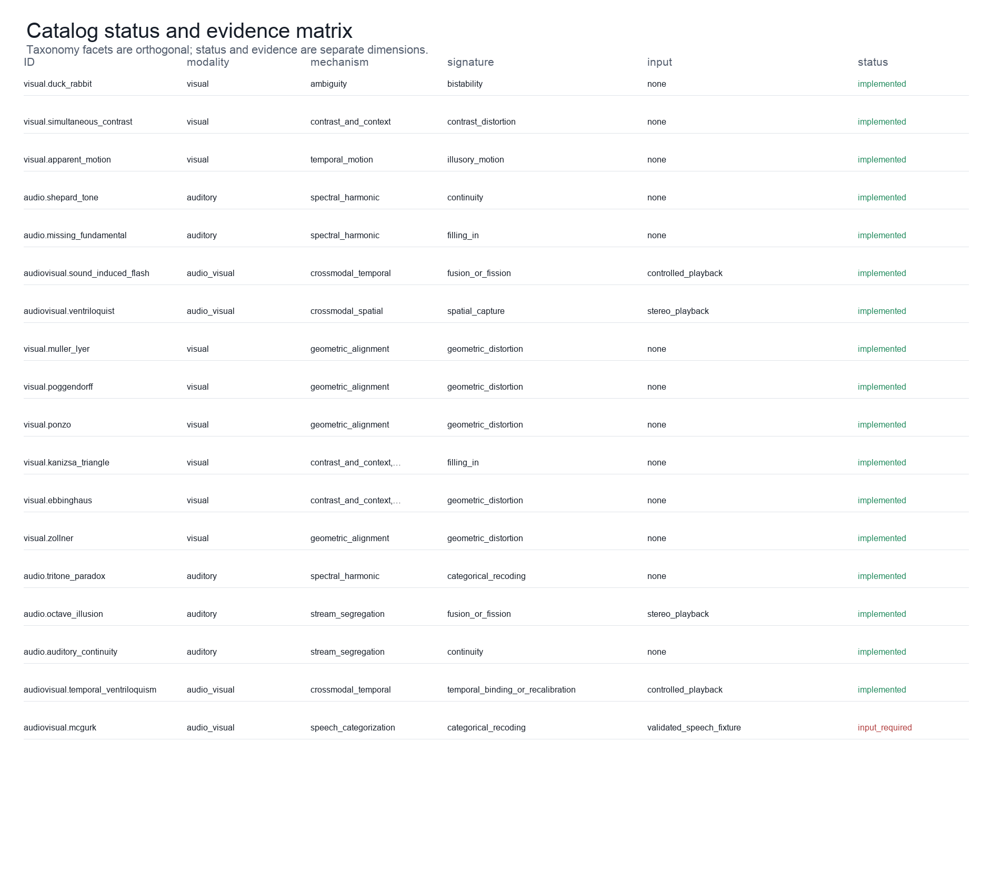
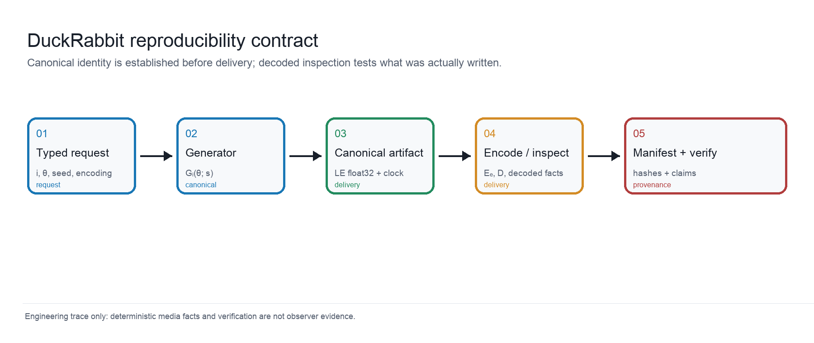
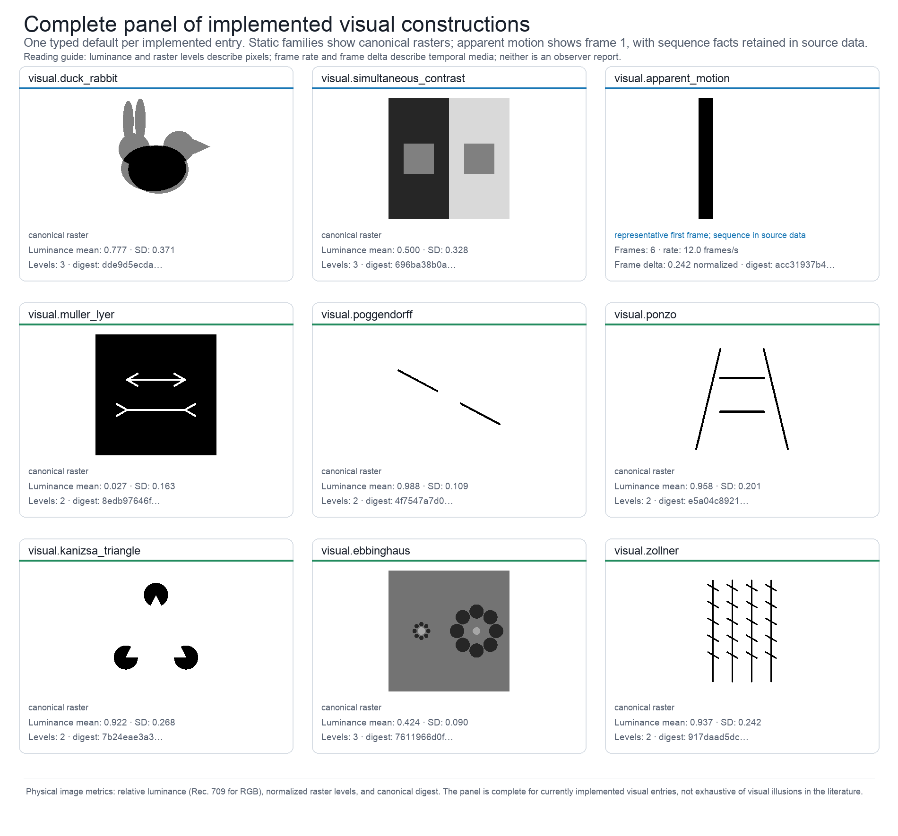
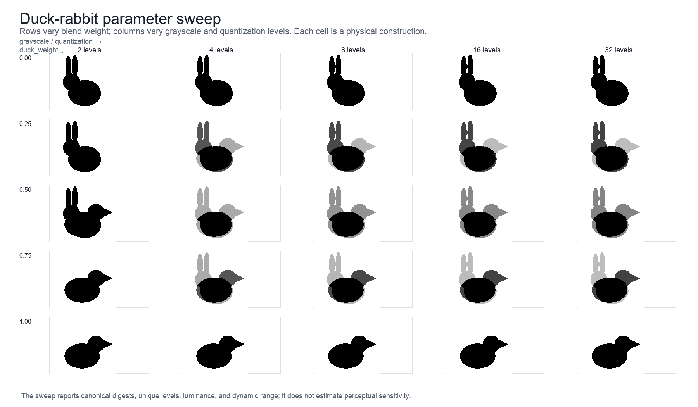
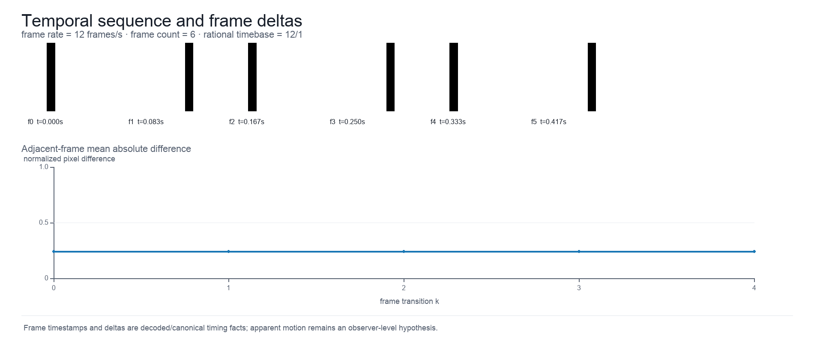
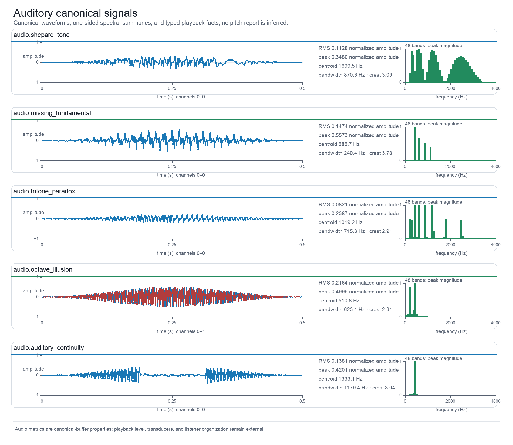
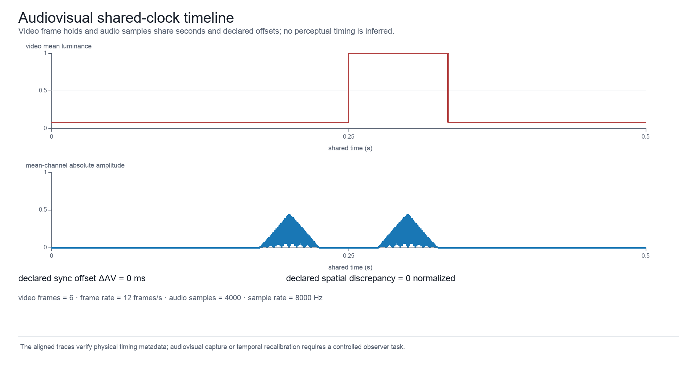
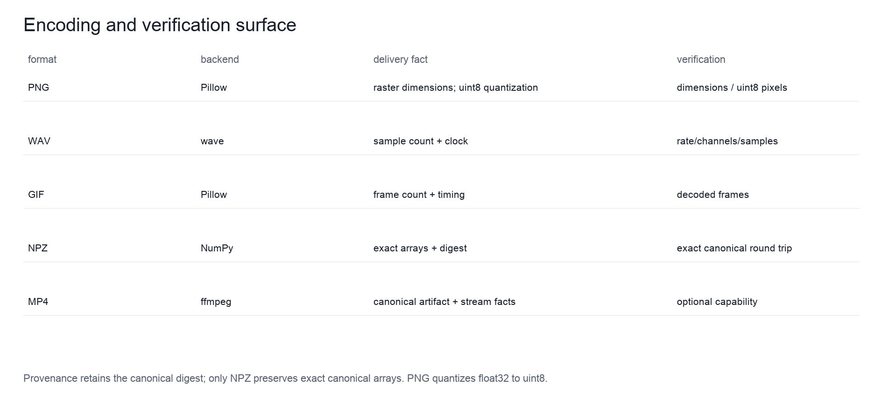
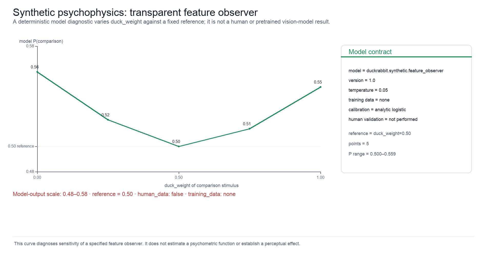

# Computed Stimulus Atlas and Synthetic-Observer Diagnostics {#sec:results}

This section reports software-derived constructions, registry summaries, and
objective media measurements, not empirical observer findings. The atlas is
generated by the current unreleased source; its presence does not establish
that a release deposit or typeset-output review has been completed.

## Deterministic multimodal construction and verification at a glance

{#fig:graphical_abstract}

{{FIGURE_CAPTION_GRAPHICAL_ABSTRACT}}

The graphical abstract [@fig:graphical_abstract] connects typed requests to
canonical visual, auditory, temporal, and audiovisual artifacts, then to
objective measurements, optional encoded delivery, and verification records.
It summarizes the construction and audit contract: deterministic media facts
and source-linked family descriptions do not establish what an observer
perceives. The following panels resolve these stages and their limitations;
the synthetic diagnostic remains explicitly nonhuman model output.

## Registry counts and source-backed implementation coverage

The live registry reports {{IMPLEMENTED_GENERATORS}} implemented generators,
{{CATALOG_ENTRIES}} catalog entries, {{EVIDENCE_RECORDS}} evidence records, and
{{SCHOLARLY_SOURCES}} source records in the checked-in scholarship audit
snapshot. The companion figure keeps the categorical registry, source namespace,
and implementation statuses visible at a glance.

{#fig:catalog_matrix}

{{FIGURE_CAPTION_CATALOG_MATRIX}}

The complete catalog matrix [@fig:catalog_matrix] is tabulated in Appendix A
[@sec:appendix_catalog; @tbl:catalog]. The corresponding machine-readable
evidence matrix records the source role, exact supported claim, engineering
departure, and limitation for every entry. This separation keeps the main
narrative focused on computed outputs without duplicating mutable table rows.

## Parameter bounds and environment-dependent delivery capabilities

| Type | Unit | Validated domain | Role |
|---|---|---|---|
{{PARAMETER_TABLE_ROWS}}

: Typed parameter domains and units. {#tbl:parameters}

The parameter contracts are summarized in [@tbl:parameters]. They constrain
physical construction and serialization; they are not psychophysical scales.

| Format | Backend | Artifact | Profile | Status |
|---|---|---|---|---|
{{ENCODING_TABLE_ROWS}}

: Encoding profiles and backend capabilities. {#tbl:encodings}

The delivery profiles are summarized in [@tbl:encodings]. Backend availability
is environment-dependent and is recorded at generation time.

The catalog distinguishes a physical construction from an observer claim. For
example, the sound-induced-flash generator establishes one flash and one or two
beep events on a shared clock; it does not establish a reported flash count.
Similarly, the temporal-ventriloquism generator exposes a declared timing
offset, while the literature reports observer-dependent temporal judgments
under specific tasks and timing conditions [@vroomen2004temporal].

## Canonical digests and encoded hashes identify different objects

{#fig:architecture}

{{FIGURE_CAPTION_ARCHITECTURE}}

The generated architecture figure [@fig:architecture] shows the separation between request,
canonical artifact, delivery adapter, decoded inspection, and manifest. The
canonical digest is the identity of the in-memory stimulus; an encoded hash is
the identity of the delivered file. The difference is intentional.

## Visual-family coverage and duck-weight/quantization sweeps

{#fig:visual_panel}

{{FIGURE_CAPTION_VISUAL_PANEL}}

The visual panel [@fig:visual_panel] is deliberately a coverage figure: it
contains one deterministic representative for every currently implemented
visual entry, including apparent motion and Zöllner in addition to the static
ambiguous-figure, contrast, geometric-context, illusory-contour, and contextual-
size families. Equalities, masks, line geometry, luminance bounds, and temporal
positions are properties of the typed rasters or sequences. They are not
observer scores, and the gallery is not an exhaustive ontology of visual
illusions.

{#fig:visual_sweep}

{{FIGURE_CAPTION_VISUAL_SWEEP}}

The sweep [@fig:visual_sweep] varies duck-weight from 0 to 1 and jointly varies representable
grayscale and quantization levels. The source data preserve canonical digests
and unique-value counts; no perceptual score is assigned to a sweep cell.

## Frame succession and canonical audio summaries

{#fig:temporal_sequence}

{{FIGURE_CAPTION_TEMPORAL_SEQUENCE}}

The temporal figure [@fig:temporal_sequence] reports frame succession, rational frame rate, and
frame-to-frame mean absolute differences in the canonical sequence. These facts
do not establish decoded delivery timing or the strength of perceived motion.

{#fig:audio_signals}

{{FIGURE_CAPTION_AUDIO_SIGNALS}}

The auditory figure [@fig:audio_signals] shows per-channel, all-sample extrema
envelopes and declared spectral display bands for Shepard, missing-fundamental,
tritone, octave, and continuity constructions. RMS, peak, spectral centroid,
bandwidth, and channel layout are calculated from the canonical buffer with
explicit units and windowing rules; display aggregation does not replace them.
Pitch direction, pitch height, continuity, and stream organization remain
observer-level outcomes that depend on playback and task conditions.

## Shared-clock audiovisual offsets and format verification

{#fig:audiovisual_timeline}

{{FIGURE_CAPTION_AUDIOVISUAL_TIMELINE}}

The audiovisual timeline [@fig:audiovisual_timeline] displays an uncalibrated video
code-value proxy and audio amplitude on a shared clock with declared offsets.
Ventriloquist stimuli require stereo playback and spatially resolved display;
temporal binding requires controlled timing and an observer task
[@bruns2019ventriloquist; @vroomen2004temporal].

{#fig:encoding_verification}

{{FIGURE_CAPTION_ENCODING_VERIFICATION}}

The encoding matrix [@fig:encoding_verification] distinguishes declared adapter
contracts and verification targets. NPZ preserves exact canonical arrays;
actual backend availability and decoded delivery facts require the separate
generation, inspection, and verification commands.

## Canonical metric values are physical, not perceptual, results {#sec:objective_metric_results}

| Metric | Unit | Definition | Tolerance | Claim level |
|---|---|---|---|---|
{{METRIC_TABLE_ROWS}}

: Objective metric definitions and epistemic boundary. {#tbl:metrics}

The metric records in [@tbl:metrics] define computations on canonical or
decoded artifacts; their definitions are not empirical observer results.

The default duck-rabbit artifact contains {{DEFAULT_IMAGE_UNIQUE_LEVELS}}
unique raster levels and has mean normalized channel-value proxy
{{DEFAULT_IMAGE_MEAN_LUMINANCE}} (`mean_luminance`; no display calibration).
These values are live generated facts, not perceptual effect sizes.

## Data-free estimands and software negative controls

| Estimand | Response and model | Reference and contrast | Uncertainty |
|---|---|---|---|
{{OBSERVER_TABLE_ROWS}}

: Planned observer outcomes and data-free estimand contracts. {#tbl:observer_estimands}

The analysis contract in [@tbl:observer_estimands] specifies estimands and
uncertainty procedures without asserting any result.

| Failure mode | Control | Expected result |
|---|---|---|
{{VERIFICATION_TABLE_ROWS}}

: Verification failure modes and negative controls. {#tbl:verification}

The negative controls in [@tbl:verification] specify package-integrity and media
checks. Expected outcomes are not a test-run receipt or null findings about perception.

## A serialized feature observer yields synthetic sensitivity, not human data

{#fig:synthetic_psychophysics}

{{FIGURE_CAPTION_SYNTHETIC_PSYCHOPHYSICS}}

The diagnostic [@fig:synthetic_psychophysics] evaluates a fully serialized,
hand-specified feature observer against a fixed canonical reference while
varying `duck_weight`. Its logistic probabilities are model outputs generated
from explicit features, weights, temperature, and seed; they are not a
pretrained vision-model score, a human psychometric function, an assumed human
effect size, or participant data. A future human study would require a
preregistered task, calibrated display and playback, consented participants,
exclusion and missingness rules, and an analysis contract before any observer
claim could be made.
