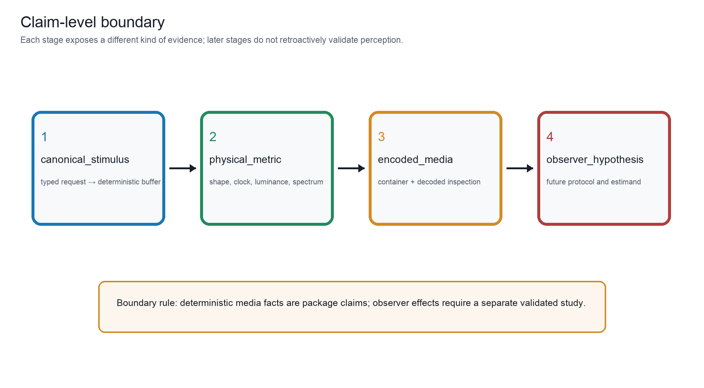
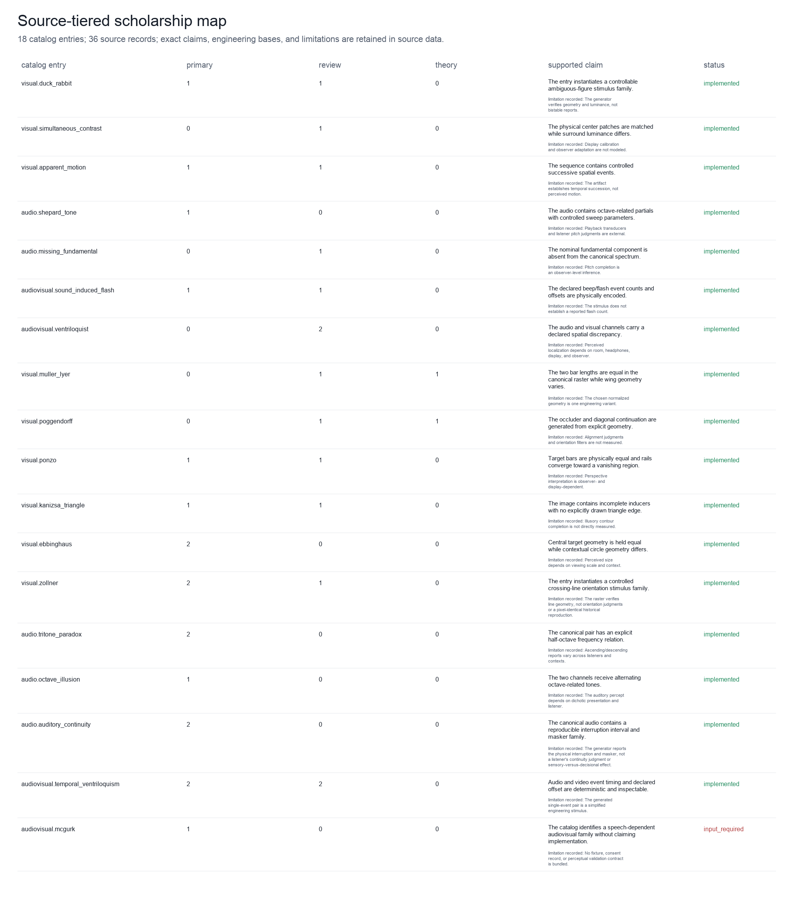
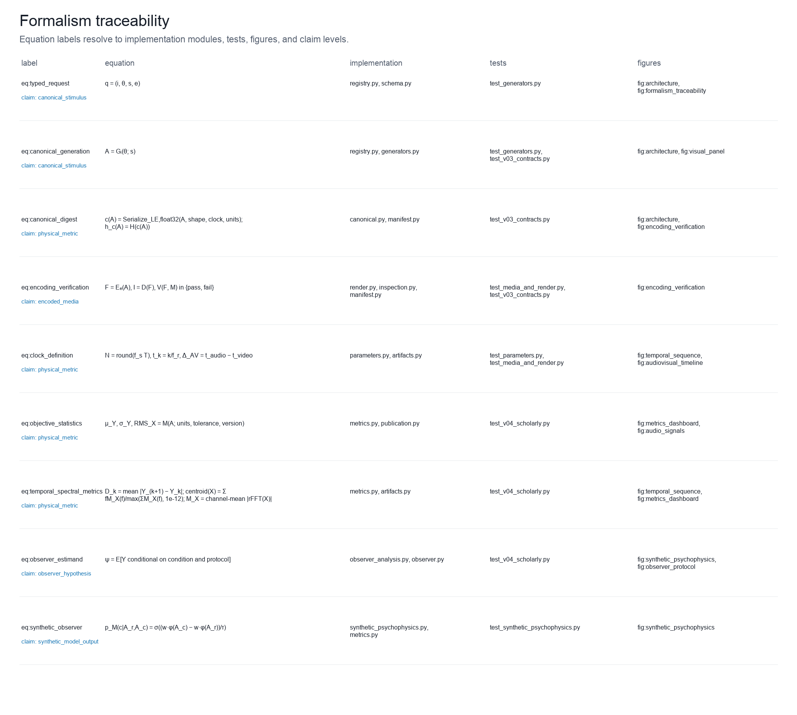
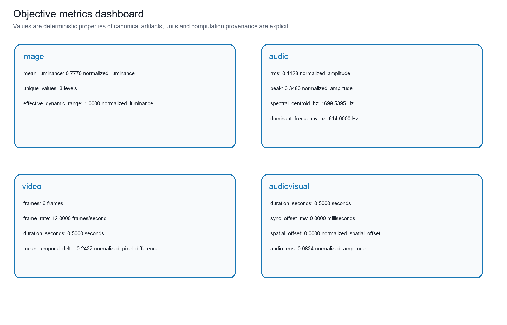
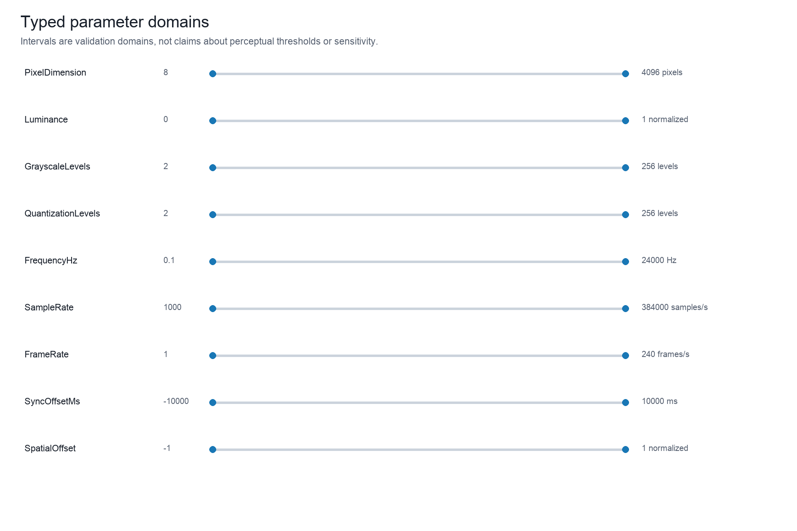
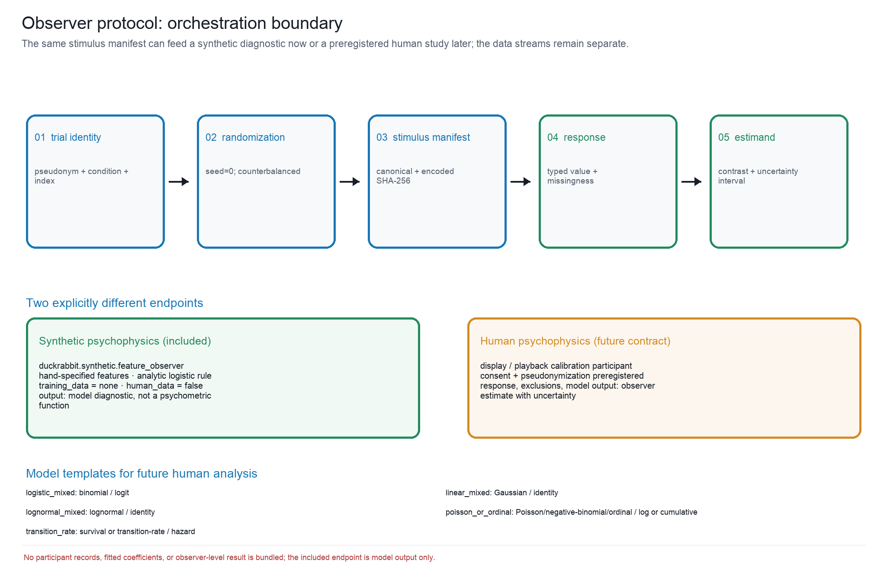

# Figure Lineage, Equation Traceability, and Scholarship Audit Boundaries {#sec:publication_audit}

The publication layer is generated from the same typed package state as the
stimuli. It contains {{PUBLICATION_FIGURES}} scientific figures, {{PUBLICATION_TABLES}}
machine-readable tables, and a separately provenance-recorded editorial cover.
The cover is an illustration of the project's subject and methods aesthetic; it
is not a stimulus, a participant result, or evidence of a perceptual effect.

Dense catalog, auditory, scholarship and formalism overviews also have
source-derived readable detail variants. Their dedicated panel report retains
record identities and exact source/raster provenance; these presentation views
do not add generators, scientific figures, datasets or observer findings.
Declared renderer adapters supply readable detail contexts without changing the
canonical figure labels or source data. Native replay and actual delivery-scale
inspection remain separate acceptance obligations.

## Claim levels separate buffers, measurements, delivery, and observer hypotheses

{#fig:claim_boundary}

{{FIGURE_CAPTION_CLAIM_BOUNDARY}}

The claim boundary in [@fig:claim_boundary] is a typed epistemic interface. A
canonical digest identifies a deterministic buffer; objective metrics identify
properties of that buffer; encoded-media verification identifies facts of the
delivered file. A future observer hypothesis is a different object with its
own protocol, estimand, and planned uncertainty procedure.

## Source roles and versioned metadata preserve scholarly lineage

{#fig:scholarship_map}

{{FIGURE_CAPTION_SCHOLARSHIP_MAP}}

The source map [@fig:scholarship_map] and [@tbl:evidence_audit] make five
distinctions explicit: a primary demonstration, a review, a theoretical
account, DuckRabbit's engineering basis, and an evidence limitation. Brugger's
duck/rabbit study documents variation across figure variants and observers;
this supports a careful ambiguity-family record, not a universal bistability
claim [@brugger1999duckrabbit]. Yildiz et al. review competing explanations of
Ponzo-like illusions, so the catalog retains both a geometric construction and
an unresolved theoretical boundary [@yildiz2022ponzo]. Repp's tritone analysis
likewise motivates listener- and context-sensitive limitations
[@repp1997tritone].

The audit also treats software and its metadata as part of the scholarly
record. FAIR guidance emphasizes machine-actionable provenance and reuse, and
software-citation principles emphasize crediting an identifiable version rather
than citing an undifferentiated project name [@wilkinson2016fair;
@smith2016software]. Accordingly, the package includes `CITATION.cff`,
CodeMeta, Zenodo metadata, versioned manifests, source-data sidecars, and
resolver-linked bibliography entries. These improve discoverability and
attribution; they do not increase the evidential level of any perceptual claim.

The public software identity is explicit: DuckRabbit source is available
at the [DuckRabbit public GitHub repository](https://github.com/docxology/DuckRabbit)
under the authorship of Daniel Ari Friedman, Active Inference Institute. The
current {{PACKAGE_VERSION}} source is unreleased and distinct from the already-published
v0.5.0 archive; its DOI remains forthcoming. Source and manuscript corrections
require a new versioned deposit. Native PDF/HTML/slides rendering and page-level
validation are separate gates, not implied by a passing package audit.

## Equations link to implementations; metric plots retain objective units

{#fig:formalism_traceability}

{{FIGURE_CAPTION_FORMALISM_TRACEABILITY}}

The formalism registry [@fig:formalism_traceability] links equations
[@eq:typed_request; @eq:canonical_generation; @eq:canonical_digest; @eq:encoding_verification; @eq:clock_definition; @eq:objective_statistics; @eq:temporal_spectral_metrics; @eq:observer_estimand; @eq:synthetic_observer]
to implementation modules, tests, and figures. The contract is intentionally
auditable: equation labels point to code-owned records, while empirical claims
remain outside the generator's authority.

{#fig:metrics_dashboard}

{{FIGURE_CAPTION_METRICS_DASHBOARD}}

The metrics dashboard [@fig:metrics_dashboard] reports units, computation
version, and canonical digests. Luminance statistics are normalized raster
properties; RMS and peak are normalized-amplitude properties; spectral values
are in Hz; frame deltas are normalized pixel differences; and synchronization
offsets are in milliseconds. None is a psychophysical score.

{#fig:parameter_domains}

{{FIGURE_CAPTION_PARAMETER_DOMAINS}}

The domain map [@fig:parameter_domains] is a validation visualization. Bounds
are chosen to prevent malformed media and unsafe encodings, not to predict a
viewer, listener, or participant's sensitivity.

## Trial records and synthetic diagnostics stop short of observer evidence

{#fig:observer_protocol}

{{FIGURE_CAPTION_OBSERVER_PROTOCOL}}

The observer-design diagram [@fig:observer_protocol] starts with a pseudonymous
trial identity and deterministic randomization, binds the stimulus manifest and
encoded hash, and records a typed response or missingness state. Its estimand
must be specified by a future protocol, not inferred from the diagram. The companion diagnostic
[@fig:synthetic_psychophysics] is a deterministic, hand-specified feature
observer with `training_data=none` and `human_data=false`; it is not a
pretrained vision model, psychometric function, or participant result. Human
psychophysics remains a future evidence layer requiring calibrated playback,
consent, preregistration, and observed responses.

## Generated tables expose captions, evidence, formalism, and claim lineage

| Figure / claim level | Source and evidence | Controls and objective facts | Limitations, boundary, and accessibility |
|---|---|---|---|
{{CAPTION_AUDIT_TABLE_ROWS}}

: Code-owned caption, source-data, and accessibility audit. {#tbl:caption_audit}

| Key | Record and citations | DOI and URL | Verification | Supported claim / engineering / limitation |
|---|---|---|---|---|
{{EVIDENCE_AUDIT_TABLE_ROWS}}

: Source-tiered evidence, DOI/URL verification, exact supported claims, engineering departures, limitations, and explicit planned/input-required gaps. {#tbl:evidence_audit}

| Label | Definition and symbols | Implementation and tests | Figures and claim level |
|---|---|---|---|
{{FORMALISM_TABLE_ROWS}}

: Formal equation-to-code traceability. {#tbl:formalism}

| Claim ID | Claim and level | Basis | Lineage and limitation |
|---|---|---|---|
{{CLAIM_LEDGER_TABLE_ROWS}}

: Claim ledger separating code-derived facts, scholarship, engineering departures, limitations, scope, and observer hypotheses. {#tbl:claim_ledger}

The source-tiered evidence table [@tbl:evidence_audit], caption audit
[@tbl:caption_audit], formalism registry [@tbl:formalism], and claim ledger
[@tbl:claim_ledger] are generated sidecars. They provide a publication appendix
without duplicating mutable counts or silently converting literature statements
into package results.

Strict auditing compares scientific panels and data with fresh derivations from the trusted
current code. Renderer, font and dependency identities bound exact raster replay;
tables and hydrated prose are separately compared with their current definitions.
This detects coordinated data/hash substitutions but does not authenticate authorship
or establish empirical scientific validity. Human page inspection remains separate.

The cover validator checks its real source asset, dimensions, PNG/WebP/thumbnail
roles and transforms. Its historical prompt/model/candidate history is reported
and unverified rather than inferred from the pixels. Arbitrary supplied images
receive no such history. Neither scientific nor editorial output supplies an
observer result or replaces display calibration or behavioral data.

Formalism checks resolve contained package/test paths, manuscript labels and
figure links; file existence is traceability, not proof of mathematical equivalence.
The network evidence audit covers {{SCHOLARLY_SOURCES}} evidence sources, not every
manuscript reference. URL reachability, bibliographic identity, full-text support
and observer validity remain distinct evidence obligations.
