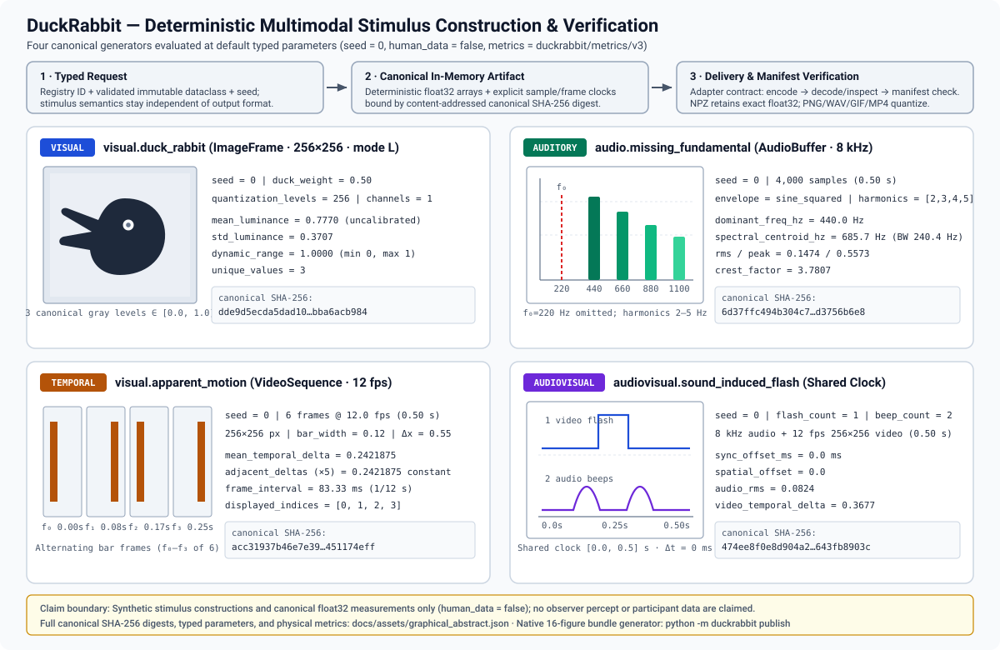

# DuckRabbit: deterministic multimodal stimulus construction

[](https://doi.org/10.5281/zenodo.21419693)
[](../LICENSE)

DuckRabbit is a typed Python package for constructing visual, auditory,
temporal, and audio-visual illusion stimuli. The same typed request and seed
produce canonical in-memory media that can be hashed, inspected, and exported
as PNG, WAV, GIF, MP4, or exact canonical NPZ. A family name describes stimulus
intent, not a guarantee of what an observer sees or hears.

**0.6.0 is unreleased; its DOI is forthcoming.** The latest released version is
v0.5.0. The MIT-licensed [public repository](https://github.com/docxology/DuckRabbit)
owns the package, tests, manuscript, evidence matrix, and native publication
workflow. No private workspace or sibling checkout is required for these tasks.

Start at the **[documentation task index](README.md)**. It separates
current guides from dated evidence, and directs installation, API use,
visualization, verification, and release work without duplicating workflows.



The [graphical abstract's source data](assets/graphical_abstract.json)
retain canonical digests, typed parameters, and physical metrics (`duckrabbit publish` also emits full plotted arrays in `data/graphical_abstract.json` inside a generated bundle).

## Install and generate a verifiable stimulus

From the checkout root:

```bash
uv sync --locked --extra dev
uv run python -m duckrabbit list
uv run python -m duckrabbit generate visual.duck_rabbit --output-dir output/media
uv run python -m duckrabbit inspect output/media/visual_duck_rabbit.png
uv run python -m duckrabbit verify output/media/visual_duck_rabbit.png.json
uv run python -m duckrabbit capabilities
```

The supported Python floor is **3.11** (`pyproject.toml`); the checkout selects
**3.15** (`.python-version`). A retained run on 3.15.2 is a dated observation,
not an exact patch pin or proof that every environment can resolve the lock.
The `dev` extra supplies test and documentation-generation dependencies.
Pillow handles PNG/GIF, standard-library WAV handles PCM, and optional system
ffmpeg/ffprobe enable MP4 delivery/inspection. See the
[quickstart](quickstart.md) for overrides, other modalities, and errors.

Wheels include runtime evidence and bibliography resources. Publication
production, manuscript hydration, and checkout/release auditing require the
full source tree; an installed-wheel smoke test is a different contract.

## Use canonical media through the typed API

```python
from duckrabbit import ImageConfig, QuantizationLevels, generate
from duckrabbit.generators import DuckRabbitParams

stimulus = generate(
    "visual.duck_rabbit",
    DuckRabbitParams(
        config=ImageConfig(quantization_levels=QuantizationLevels(8)),
    ),
)
print(stimulus.width, stimulus.height, stimulus.mode)
```

Canonical `ImageFrame`, `AudioBuffer`, `VideoSequence`, and
`AudiovisualTimeline` objects separate stimulus parameters from delivery
choices. For an encoded request:

```python
from duckrabbit import AudioEncoding, MediaFormat, OutputSpec, PcmBitDepth
from duckrabbit.render import generate_artifact

_, manifest = generate_artifact(
    "audio.missing_fundamental",
    output_dir="output/media",
    output_spec=OutputSpec(
        format=MediaFormat.WAV,
        audio_encoding=AudioEncoding(PcmBitDepth(24)),
    ),
)
print(manifest["schema_version"], manifest["verification"]["status"])
```

Use `list --json` and `describe ID` for the live catalog and typed defaults,
rather than a second handwritten roster. `implemented`, `planned`, and
`input_required` are distinct states. McGurk remains input-dependent until
real checksummed speech fixtures and their validation contract are available.
[Architecture](architecture.md) maps public contracts to owning modules.

## Read figures without mistaking presentation for evidence

The [visualization guide](visualization.md) owns the live figure roster,
scientific graphical abstract versus editorial cover distinction, source-data
interfaces, signal-display conventions, and readability review criteria.
[Publication](publication.md) owns the native generation/hydration recipe
and separate typesetting boundary. Figure rendering uses NumPy/Pillow, not
Matplotlib; font bytes and environment matter for raster replay.

The designated current-source staging path is `output/visual-review-2026-11-08/`
(generated locally via [docs/publication.md](publication.md)); its own
generation, runtime and visual-review receipts define acceptance. The retained
[`output/review-2026-11-08/`](../output/review-2026-11-08/) is the earlier source-bound
baseline, not validation of subsequent edits. Neither is an archival 0.6.0
release. Dated receipts in the [documentation index](README.md#dated-historical-receipts)
remain evidence only for their recorded inputs.

## Verify software, then assess the claim boundary

[Testing and security boundaries](testing_philosophy.md) define native
gates and real-media negative controls. A passing structural/hash/replay audit
is trusted-code consistency, not actual visual inspection, independent
scientific replication, source authorship authentication, or a decoder sandbox.
[Scholarship](scholarship.md) distinguishes offline lineage checks from
live title/author/year verification; unresolved identities still block release.
[Profiling](performance.md) separates uninstrumented timing from diagnostic
instrumentation and preserves environment/source bindings.

Metrics describe physical signals. `mean_luminance` is an uncalibrated
code-value proxy, not measured display luminance. Synthetic diagnostics serialize
a hand-specified model with `human_data=false`; finite sensitivity envelopes
are neither participant uncertainty nor confidence intervals. No participant
data or pretrained vision-model results are bundled.

## Cite the released version, not an unminted candidate

Daniel Ari Friedman, Active Inference Institute,
[ORCID 0000-0001-6232-9096](https://orcid.org/0000-0001-6232-9096), is the author.
The immutable v0.5.0 identifiers are:

- Concept DOI: [10.5281/zenodo.21419693](https://doi.org/10.5281/zenodo.21419693).
- v0.5.0 version DOI: [10.5281/zenodo.21419694](https://doi.org/10.5281/zenodo.21419694).

Use [CITATION.cff](../CITATION.cff) and the underlying
[bibliography](manuscript/references.bib). Historical PDF byte identities
are distinguished in the [dated November audit](audit-2026-11-08.md#historical-pdfs--actual-downloaded-byte-verification);
a concept DOI or old PDF does not identify unreleased source. See the
[release checklist](public-release-checklist.md) before creating any new
tag, release, or deposit.
